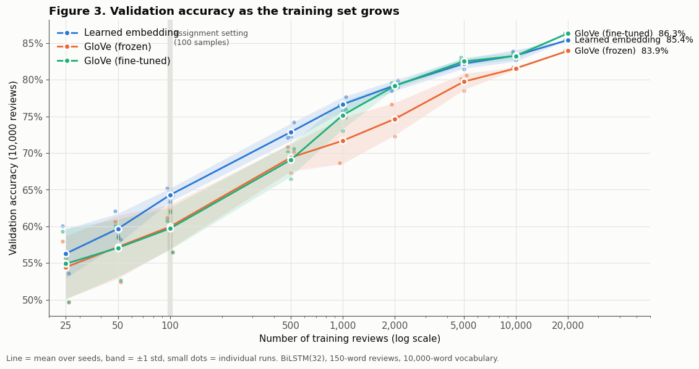
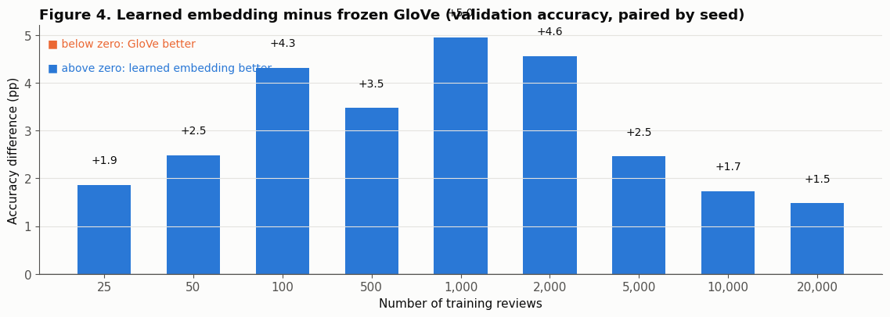
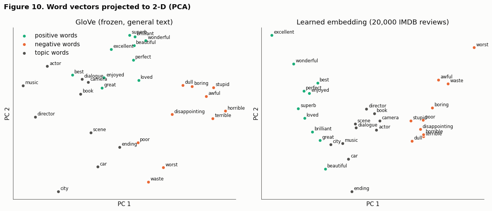

# Assignment 4: Text and Sequence Data

IMDB sentiment classification with a bidirectional LSTM. I compare an embedding layer learned from scratch against pretrained GloVe embeddings when training data is limited.

## Setup

| Requirement | Value used |
|---|---|
| Review length | cut off after **150 words** |
| Training samples | **100** (Experiment 1), then 25 to 20,000 (Experiment 2) |
| Validation samples | **10,000** (same fixed set in every run) |
| Vocabulary | top **10,000** words |
| Embeddings compared | learned `Embedding` (128-d), GloVe 6B 100-d **frozen**, GloVe 6B 100-d **fine-tuned** |

Model: `Embedding → Bidirectional(LSTM(32)) → Dropout(0.5) → Dense(1, sigmoid)`, RMSprop, early stopping on validation accuracy.
Each training size was repeated with 3 random seeds (2 at 10,000 and 1 at 20,000), 72 training runs in total. An extra 10,000-review test set was kept aside to confirm the validation numbers. The notebook was run on Kaggle (GPU T4).

## Results

Validation accuracy (mean over seeds):

| Training reviews | Learned embedding | GloVe (frozen) | GloVe (fine-tuned) |
|---:|---:|---:|---:|
| 25 | **56.3%** | 54.4% | 54.9% |
| 50 | **59.7%** | 57.2% | 57.1% |
| **100** | **64.3%** | 59.9% | 59.7% |
| 500 | **72.9%** | 69.4% | 69.1% |
| 1,000 | **76.6%** | 71.7% | 75.2% |
| 2,000 | 79.2% | 74.6% | 79.2% |
| 5,000 | 82.2% | 79.7% | **82.5%** |
| 10,000 | **83.3%** | 81.5% | 83.2% |
| 20,000 | 85.4% | 83.9% | **86.3%** |

Best model: fine-tuned GloVe with 20,000 reviews, **86.3% validation / 85.9% test**.

## Conclusions

1. **With 100 training reviews, the learned embedding did better than pretrained GloVe**: 64.3% vs. 59.9% over three seeds, winning on every seed.
2. **There was no crossover point in the range I tested.** The learned embedding was ahead of frozen GloVe at every size from 25 to 20,000 reviews, and won every seed from 50 reviews up. Its lead was largest at 1,000-2,000 reviews (about 5 points) and shrank to 1.5 points at 20,000.
3. **Fine-tuning GloVe is the best option once there is enough data.** It catches up with the learned embedding at about 1,000-2,000 reviews and is the best model at 5,000 and 20,000.
4. **Why GloVe did not help:** GloVe vectors come from Wikipedia and news text and are organised by topic and context, not sentiment. Positive and negative words are only weakly separated (Figure 10), so the frozen model has to recover sentiment from vectors that were not built for it.

## Files

| File | Contents |
|---|---|
| `Assignment4_Text_and_Sequence.ipynb` | Code with all outputs (executed on Kaggle) |
| `Assignment4_Text_and_Sequence.html` | Same notebook exported to HTML |
| `figures/` | All 10 figures: review lengths, learning curves, accuracy vs. size, paired differences, seed spread, overfitting gap, validation vs. test, training cost, accuracy heatmap, word-vector PCA |

Data sources: IMDB Large Movie Review Dataset (Maas et al., 2011) and GloVe 6B (Pennington et al., 2014). The notebook downloads both automatically.
